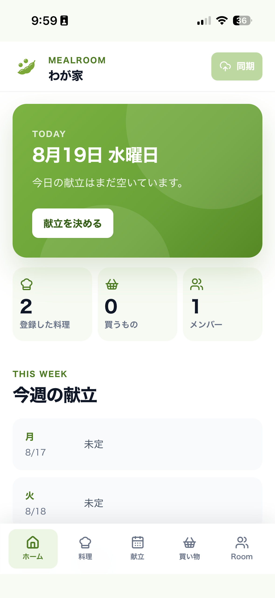
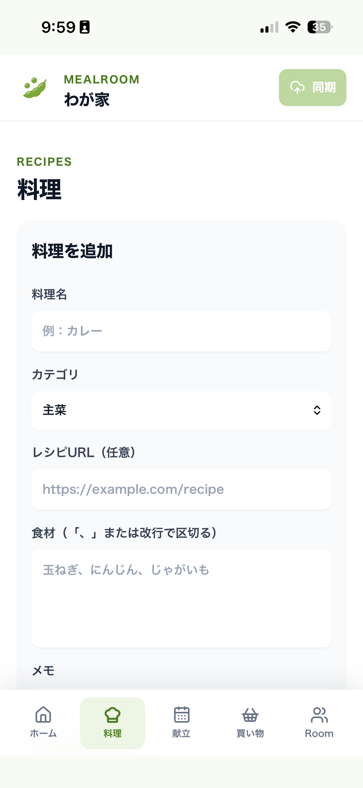
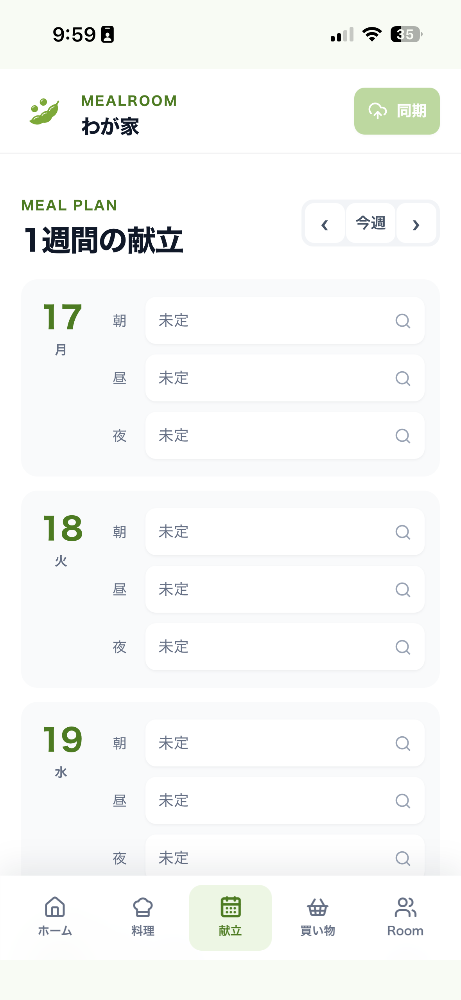
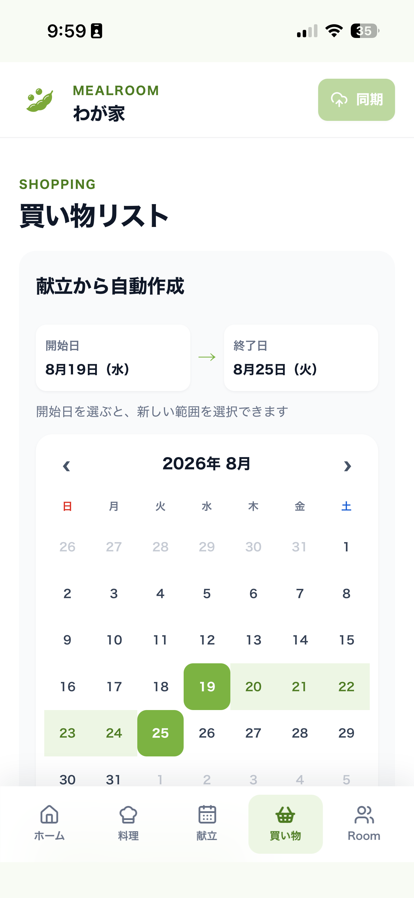
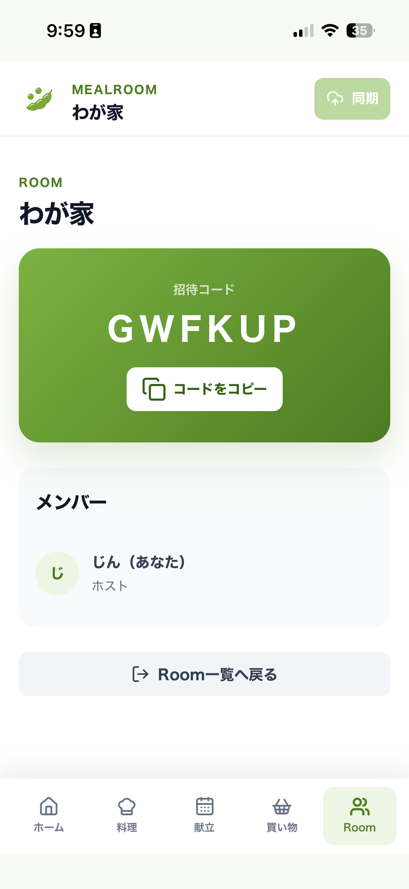

# MealRoom

<p align="center">
  
</p>

<p align="center">
  <strong>MealRoom</strong><br>
  献立から買い物まで、ふたり・家族でひとつに。
</p>

[MealRoomを使ってみる](https://meal-room.link/) ・ [画面を見る](#画面一覧)

**目次:** [サービス概要](#サービス概要) ・ [はじめかた](#はじめかた) ・ [できること](#mealroomでできること) ・ [画面一覧](#画面一覧) ・ [開発ガイド](#開発環境)

MealRoomは、家族やパートナーと料理・献立・買い物リストをひとつのRoomで共有する、スマートフォン中心のWebサービスです。「今日何を作る？」「買うものは何？」を、別々のメモではなく食卓の準備の流れとしてまとめます。

## サービス概要

料理の候補を登録し、週の献立を一緒に考え、必要な食材を買い物リストへ。MealRoomは、毎日の食事を決める小さな相談を、家族やパートナーと続けやすくすることを目指しています。

### こんな方に

- 献立を考えるとき、家族と相談しながら決めたい
- レシピや料理のメモを、次に作るときのために残しておきたい
- 献立に必要な食材をまとめて、買い忘れを減らしたい

### はじめかた

1. [MealRoomを開く](https://meal-room.link/)。初回はユーザーネームを登録します。
2. Roomを作成して招待コードを共有するか、受け取ったコードで参加します。
3. 料理を登録し、献立を決めて、買い物リストを作ります。
4. 変更を共有するときは画面上部の「同期」を押します。

Roomに参加するメンバーは、それぞれの端末のブラウザから同じRoomを開けます。ほかのメンバーの更新は定期的に取得しますが、自分の変更は「同期」を押すまで共有されません。

### MealRoomでできること

| 料理 | 献立 | 買い物 | Room共有 |
| --- | --- | --- | --- |
| 料理名、カテゴリ、食材、メモ、レシピURLを登録 | 週ごとに朝・昼・夜の予定を作成 | 期間内の献立から食材をまとめてリスト化 | 招待コードで家族やパートナーを招待 |
| 登録した料理を検索・再利用 | 日ごとの予定を見渡して編集 | 手動追加、購入済みチェック、並べ替え | Roomごとに料理・献立・買い物を管理 |

### ご利用前に

MealRoomは現在MVPとして提供しています。現行版ではユーザー認証やRoomごとのアクセス制御が十分ではなく、招待コードは本人確認やデータ保護を保証するものではありません。ユーザーネームにはニックネームを使い、本名・住所・連絡先などの個人情報や、第三者に知られたくない情報は登録しないでください。

### よくある質問

**アカウント登録やログインは必要ですか？**

ログインはありません。初回に登録するユーザーネームとRoom一覧は、利用中のブラウザ・端末に紐づきます。別の端末からRoomを開くときは、招待コードで参加してください。

**変更は自動で共有されますか？**

ほかのメンバーの変更は定期的に取得します。自分が行った変更は、画面上部の「同期」を押すと共有されます。

**レシピサイトから料理を自動登録できますか？**

レシピURLを料理に保存して、あとから外部ブラウザで開けます。レシピの内容を自動で取り込む機能はありません。

## UIコンセプト

UIは `#7CB342` を中心に、Untitled UIのような余白・タイポグラフィ・状態表示を重視した、静かで実用的なスマートフォン優先設計です。カードの輪郭線を極力使わず、背景色・余白・面のコントラストで情報のまとまりを表現します。

| 要素 | デザイン方針 | 画面での役割 |
| --- | --- | --- |
| ブランドカラー | `#7CB342`（リーフグリーン） | 同期、追加、選択中などの主要アクション |
| サーフェス | 白い面と淡い `#F8FBF4` の背景 | 枠線に頼らず、情報の階層をつくる |
| 角・余白 | 大きめの角丸と一定の間隔 | 料理・献立・買い物をひとつのリズムで見せる |
| 状態表示 | 「同期済み」「未同期の変更あり」「同期中」 | Roomの共有状態を把握できるようにする |
| タイポグラフィ | 大きな見出しと短いラベル | 片手操作でも重要な情報を先に読めるようにする |

### 画面の構成
- **Home**: Roomの状態と今週の献立を最初に確認するダッシュボード
- **Recipes**: 料理名・カテゴリ・食材・メモ・レシピURLを一緒に管理。URLはアプリ内に閉じず、外部ブラウザで開く
- **Meal plan**: 朝・昼・夜を日付ごとに編集し、週の流れを見渡す
- **Shopping**: 献立からの自動集計と手動追加を同じリストで扱う

## 画面一覧

MealRoomは、Roomを中心に料理・献立・買い物をつなげて管理します。画面はスマートフォンでの操作を前提に、下部ナビゲーションから切り替えられます。

### 1. ホーム

<p align="center">
  
</p>

#### 概要

Roomの状況と、今日・今週の献立をまとめて確認するダッシュボードです。

#### 主な機能

- 今日の献立を表示
- 「献立を決める」から献立画面へ移動
- 登録した料理数、未購入の買い物項目数、Roomメンバー数を表示
- 今週の献立を曜日ごとに確認
- 同期状態（同期済み／未同期の変更あり／同期中）を確認

---

### 2. 料理

<p align="center">
  
</p>

#### 概要

家庭で登録した料理を一覧で管理し、献立づくりに再利用する画面です。

#### 主な機能

- 料理の追加・編集・削除
- 料理名、カテゴリ、食材、メモを登録
- 任意のレシピURLを登録し、外部ブラウザで参照
- 登録した料理を献立登録や買い物リストの自動集計で利用

---

### 3. 献立

<p align="center">
  
</p>

#### 概要

1週間の予定を見渡しながら、日ごとの朝・昼・夜に料理を割り当てる画面です。

#### 主な機能

- 前週・次週・今週へ切り替え
- 朝・昼・夜の各枠に料理を登録
- 登録済みの料理を料理名・カテゴリ・食材で検索して選択
- 各枠を「未定」に戻す
- 登録した献立を買い物リストの集計元として利用

---

### 4. 買い物リスト

<p align="center">
  
</p>

#### 概要

指定した期間の献立から必要な食材を自動でまとめ、買い物の進捗を管理する画面です。

#### 主な機能

- 開始日・終了日を指定（最大31日）
- 期間内の献立から食材を自動集計
- 食材の重複を除去して一覧化
- 買い物項目の手動追加・削除
- 購入済みチェック
- 自動生成（献立から）と手動追加の項目を区別

---

### 5. Room

<p align="center">
  
</p>

#### 概要

家族や同居人と同じデータを共有するためのRoom情報を確認する画面です。

#### 主な機能

- Room名と招待コードを表示
- 招待コードをコピー
- メンバー一覧とホスト／メンバーの役割を表示
- 自分のメンバー表示を確認
- Room一覧へ戻る

### アイコン

MealRoomのアイコンは、リーフグリーンの葉と小さな丸いモチーフで「食材」「成長」「一緒に育てる食卓」を表現しています。透明背景版をWeb、iOS、Androidで共通利用し、アプリ内ではブランドカラーと同じグリーンで統一しています。

- 原画像: [`asset/icon-meal-room-transparent.png`](asset/icon-meal-room-transparent.png)
- Web公開用: [`web/public/icon-meal-room-transparent.png`](web/public/icon-meal-room-transparent.png)
- Flutterアプリ用: [`mobile/assets/icon-meal-room-transparent.png`](mobile/assets/icon-meal-room-transparent.png)

## 現在の構成

```text
Flutterアプリ / Webブラウザ
          ↓ HTTPS
       CloudFront
          ↓ OAC署名
   非公開S3バケット
   ├── index.html・assets/*
   └── rooms/*.json
```

- `web/`: React、TypeScript、ViteによるWebフロントエンド。現行アプリと今後のサービスページを管理
- `mobile/`: Webアプリを表示するiOS／Android用Flutter WebViewシェル
- `backend/template.yaml`: S3、CloudFront、OACなどを作成するSAMテンプレート
- `backend/src/`: 現在Webから使用していない旧Lambda API実装
- `docs/`: 現行要件、データアクセス仕様、データモデル
- `asset/`: 元画像

WebアプリはAPI GatewayやLambdaを経由せず、CloudFront経由でS3のRoom JSONを直接`GET`／`PUT`します。SAMテンプレートにはLambdaとHTTP APIも残っていますが、現行クライアントの通信経路では使用していません。

## 実装済み機能

- Roomの作成と、6文字の招待コードによる参加
- 端末ごとのユーザーネーム登録、参加Room一覧、既存メンバーとしての再入室
- ホスト／メンバー表示
- 料理の追加、編集、削除
- 週単位の献立編集（朝・昼・夜）
- カレンダーで開始日と終了日を範囲選択
- 最大31日分の献立から食材を重複なしで自動集計
- 買い物項目の手動追加、削除、購入済み切り替え
- 3秒ごとの自動取得と、未同期差分を最新データへ統合する手動同期
- レシピ参照URLの登録とリンク表示
- CloudFront＋S3保存と、設定がない場合のローカルストレージ保存
- 日本語UI、テーマ色`#7CB342`、スマートフォン優先レイアウト

再構築の現在地と次作業は[再構築ステータス](docs/rebuild-project/rebuild-status.md)を正本とします。詳細は[要件定義](docs/rebuild-project/requirements.md)、[再構築計画](docs/rebuild-project/rebuild-plan.md)、[後継API Swagger](docs/rebuild-project/openapi.yaml)、[現行データアクセス仕様](docs/rebuild-project/api.md)、[現行データ設計](docs/rebuild-project/data-model.md)を参照してください。

レシピのカテゴリ別表示・検索、献立枠の設定、メンバー管理、買い物項目の並べ替えなど、一部の現行Web機能はViteのビルドプラグインで追加・差し替えています。再構築ではこれらの機能も引き継ぎ、通常のアプリケーションソースで管理する方針です。

## 開発環境

- Node.js 26.13.0
- npm
- Flutter SDK（この環境では3.44.8で確認）
- iOS実機ビルド時はXcodeとApple IDの署名設定
- AWS更新時はAWS CLI、AWS SAM CLI、対象リソースへの権限

日本語ロケールでコマンドを実行する場合は、必要に応じて次を設定します。

```bash
export LANG=ja_JP.UTF-8
export LC_ALL=ja_JP.UTF-8
```

## Webをローカルで起動

```bash
cd web
npm ci
npm run dev
```

`VITE_CLOUDFRONT_BASE_URL`が未設定または空の場合は、Roomをブラウザのローカルストレージへ保存します。CloudFront上の共有データを使用する場合は、`web/.env`へ次を設定してから起動またはビルドします。

```dotenv
VITE_CLOUDFRONT_BASE_URL=https://dqtgmho40xu09.cloudfront.net
```

環境変数はViteのビルド時に組み込まれます。変更後はWebを再ビルドしてください。

## 検証

Webの型チェックと本番ビルドは次で実行します。

```bash
cd web
npm run build
```

Flutterは次で静的解析とテストを実行します。

```bash
cd mobile
flutter pub get
flutter analyze
flutter test
```

## AWSインフラをSAMでデプロイ

現時点ではSAMテンプレートが`backend/`にあるため、このディレクトリから実行します。テンプレートはS3、CloudFront、OAC、キャッシュ／CORSポリシーに加え、未使用のLambdaとHTTP APIも作成します。

```bash
cd backend
npm ci
npm run build
sam build
sam deploy --guided
```

初回以降は生成された`samconfig.toml`を確認してから、通常の`sam deploy`を使用できます。主なCloudFormation出力は次のとおりです。

- `RoomBucketName`: WebファイルとRoom JSONを保存するS3バケット
- `CloudFrontDistributionId`: キャッシュ無効化に使うDistribution ID
- `CloudFrontUrl`: WebアプリとRoom JSONの公開URL
- `ApiUrl`: 旧Lambda APIのURL。現行Webでは未使用

Lambdaを完全に廃止する場合は、先にSAMテンプレートから`MealRoomApi`、`ApiFunction`、`ApiUrl`を削除し、S3／CloudFront用テンプレートを`infra/`などへ移す想定です。

## WebをS3・CloudFrontへ反映

現在使用している値は次のとおりです。

```bash
ROOM_BUCKET_NAME=meal-room
CLOUDFRONT_DISTRIBUTION_ID=E1D8RR5GS98VNY
CLOUDFRONT_DOMAIN=dqtgmho40xu09.cloudfront.net
```

Webをビルドし、同じAWSアカウント／プロファイルでアップロードします。

```bash
cd web
VITE_CLOUDFRONT_BASE_URL="https://${CLOUDFRONT_DOMAIN}" npm run build

aws s3 sync dist/ "s3://${ROOM_BUCKET_NAME}/" \
  --region ap-northeast-1 \
  --profile default

aws cloudfront create-invalidation \
  --distribution-id "${CLOUDFRONT_DISTRIBUTION_ID}" \
  --paths '/*' \
  --profile default
```

AWSコンソール日本語表示では、CloudFrontの`Invalidations`は「無効化」です。Distributionの「最終変更日」だけでなく、作成した無効化のステータスが`完了`になるまで待ってから確認します。

`aws s3 sync`の`ListObjectsV2`で`AccessDenied`になる場合、実行中のIAM PrincipalにバケットARNへの`s3:ListBucket`が必要です。アップロードには、さらに`arn:aws:s3:::meal-room/*`への`s3:PutObject`が必要です。CloudFrontのOAC用バケットポリシーはAWS CLI利用者の権限を代替しません。

## Flutterアプリを起動

Flutterシェルは、指定がなければ現行CloudFront URLの`/index.html`を開きます。

```bash
cd mobile
flutter pub get
flutter run
```

接続先を上書きする場合は`WEB_APP_URL`を渡します。

```bash
flutter run \
  --dart-define=WEB_APP_URL=https://dqtgmho40xu09.cloudfront.net/index.html
```

Android EmulatorからローカルViteへ接続する例です。

```bash
flutter run \
  --dart-define=WEB_APP_URL=http://10.0.2.2:5173
```

iPhone実機では、Xcodeの`Settings… > Accounts`へApple IDを追加し、端末のロック解除とDeveloper Modeを確認してから実行します。

```bash
flutter devices
flutter run -d <iPhoneのデバイスID> --release \
  --dart-define=WEB_APP_URL=https://dqtgmho40xu09.cloudfront.net/index.html
```

詳細は[Flutter Shell README](mobile/README.md)を参照してください。

## 現在の制約とセキュリティ

- `host`と`member`は表示用の属性で、操作権限を強制していません。
- 端末IDとメンバーIDは認証情報ではありません。
- 変更は同期ボタンを押すまで端末内に保持し、同期直前に最新Roomへ差分統合します。ただしS3直接PUTに競合検査はなく、完全に同時の更新は後勝ちです。
- `rooms/index.json`には招待コードとRoom IDの対応が含まれます。
- CloudFront URLを知るクライアントは、現在のバケットポリシーで許可された`rooms/*`を更新できます。
- 一般公開する場合は、Cognitoなどの認証と、認可・競合制御を行うAPI層への移行が必要です。
